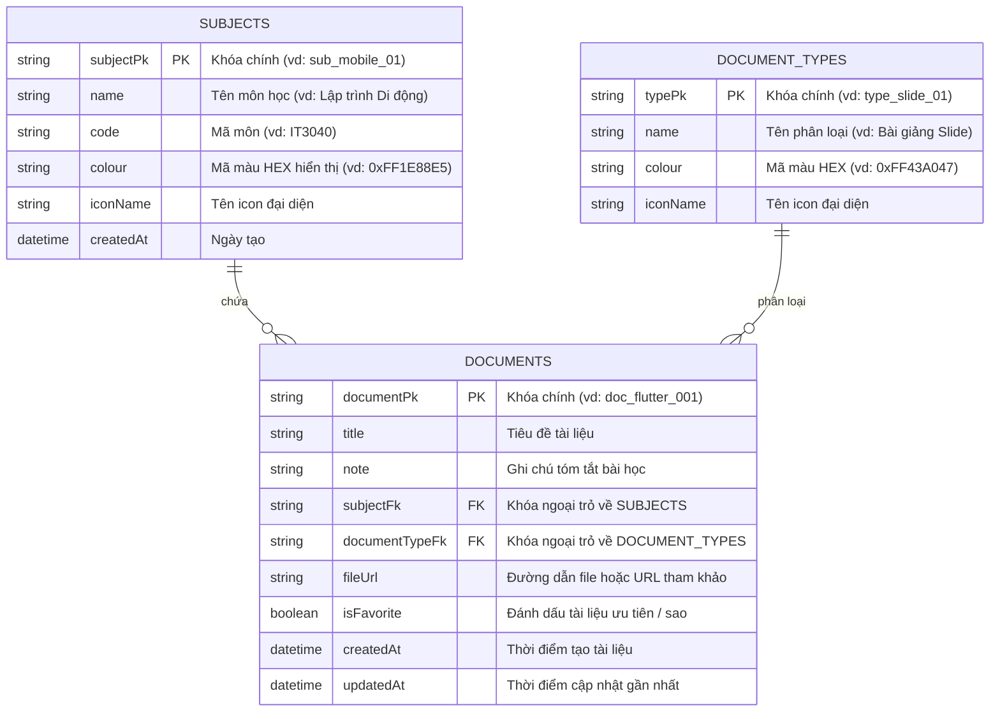
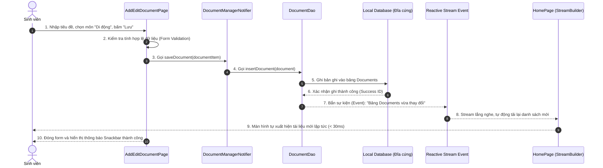
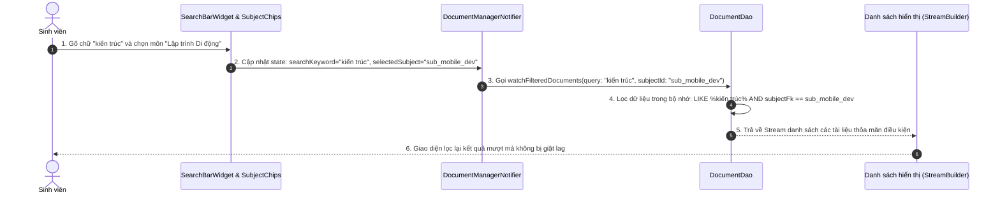
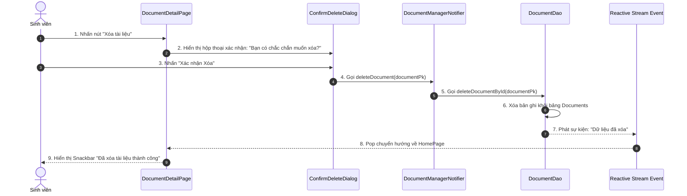

# TÀI LIỆU THIẾT KẾ KIẾN TRÚC & SƠ ĐỒ LUỒNG DỮ LIỆU
## DỰ ÁN: ỨNG DỤNG QUẢN LÝ TÀI LIỆU HỌC TẬP (LOCAL-FIRST CASHEW PATTERN)
**Mã checklist thực hiện:** Checklist 1 / 5  
**Dự án:** `quan_ly_tai_lieu_hoc_tap`  
**Kiến trúc tham chiếu:** Cashew Mobile Architecture (Local-First, Reactive Data Streams, 3-Layer Separation)

---

## 1. PHÂN TÍCH YÊU CẦU CHỨC NĂNG (FUNCTIONAL REQUIREMENTS)

Hệ thống được thiết kế để phục vụ nhu cầu học tập của sinh viên, cho phép quản lý toàn diện các dạng tài liệu (Bài giảng, Bài tập, Slide thuyết trình, Tài liệu tham khảo, Đề thi cũ) mà không phụ thuộc vào kết nối mạng Internet liên tục.

### 1.1. Ma Trận Yêu Cầu Chức Năng Cốt Lõi

| Mã YC | Tên chức năng | Mô tả chi tiết | Tiêu chí chấp nhận (Acceptance Criteria) |
| :--- | :--- | :--- | :--- |
| **FR-01** | **Thêm tài liệu mới (Create)** | Cho phép sinh viên tạo bản ghi tài liệu học tập mới kèm thông tin: Tiêu đề, Môn học, Loại tài liệu, Ghi chú, Đường dẫn/Tên file đính kèm. | - Dữ liệu được xác thực hợp lệ (tiêu đề không để trống).<br>- Tự sinh mã định danh duy nhất (`documentPk`).<br>- Ghi tức thì vào cơ sở dữ liệu cục bộ (< 30ms). |
| **FR-02** | **Xem danh sách & chi tiết (Read)** | Hiển thị danh sách tài liệu trực quan dạng thẻ (Card), hỗ trợ xem toàn bộ thông tin chi tiết của tài liệu. | - Tự động cập nhật danh sách qua Reactive Stream khi DB biến động.<br>- Hiển thị nhãn môn học và loại tài liệu với màu sắc nhận diện. |
| **FR-03** | **Chỉnh sửa tài liệu (Update)** | Cập nhật thông tin tiêu đề, môn học, ghi chú, trạng thái yêu thích của tài liệu đã tồn tại. | - Bản ghi được cập nhật với `updatedAt` mới nhất.<br>- Màn hình chi tiết và màn hình chính tự đồng bộ trạng thái mới. |
| **FR-04** | **Xóa tài liệu (Delete)** | Xóa tài liệu không còn sử dụng ra khỏi bộ nhớ cục bộ. | - Có hộp thoại cảnh báo xác nhận trước khi xóa.<br>- Danh sách tự loại bỏ tài liệu ngay sau khi xác nhận. |
| **FR-05** | **Tìm kiếm thời gian thực (Search)** | Tìm kiếm tài liệu theo từ khóa tiêu đề hoặc nội dung ghi chú. | - Tìm kiếm phản hồi ngay khi người dùng gõ phím.<br>- Không phân biệt chữ hoa/thường (Case-insensitive). |
| **FR-06** | **Lọc theo Môn học & Loại tài liệu** | Lọc nhanh danh sách theo môn học (ví dụ: Lập trình di động, Mạng máy tính) và loại tài liệu. | - Chọn "Tất cả" hoặc từng môn học cụ thể qua Filter Chip.<br>- Kết hợp đồng thời vừa tìm kiếm từ khóa vừa lọc theo môn. |
| **FR-07** | **Đánh dấu Yêu thích (Favorite)** | Ghim các tài liệu quan trọng lên đầu danh sách để truy cập nhanh. | - Chạm 1 chạm vào biểu tượng ngôi sao để bật/tắt yêu thích. |

---

## 2. THIẾT KẾ LƯỢC ĐỒ DỮ LIỆU THỰC THỂ (ERD)

Kiến trúc Cashew sử dụng mô hình cơ sở dữ liệu quan hệ cục bộ (SQLite/Drift). Dưới đây là thiết kế 3 bảng dữ liệu chính của ứng dụng Quản lý tài liệu học tập:



### Chi tiết các trường dữ liệu và mẫu bản ghi:

#### 1. Bảng `Documents` (Tài liệu học tập)
| Tên trường | Kiểu dữ liệu | Ý nghĩa | Ví dụ bản ghi |
| :--- | :--- | :--- | :--- |
| `documentPk` | String (Primary Key) | Mã định danh duy nhất UUID | `"doc_1701234567_abc"` |
| `title` | String | Tiêu đề tài liệu | `"Slide Kiến Trúc Flutter & Drift ORM"` |
| `note` | String | Ghi chú nội dung trọng tâm | `"Ôn tập kỹ mô hình Local-First và Reactive Stream"` |
| `subjectFk` | String (Foreign Key) | Mã môn học liên kết | `"sub_mobile_dev"` |
| `documentTypeFk`| String (Foreign Key) | Mã phân loại tài liệu | `"type_lecture_slide"` |
| `fileUrl` | String | Tên tệp hoặc liên kết | `"assets/docs/flutter_arch.pdf"` |
| `isFavorite` | Boolean | Trạng thái yêu thích | `true` |
| `createdAt` | DateTime | Thời gian tạo | `"2026-10-03T10:00:00Z"` |
| `updatedAt` | DateTime | Thời gian sửa đổi | `"2026-10-03T10:15:00Z"` |

#### 2. Bảng `Subjects` (Môn học)
| Tên trường | Kiểu dữ liệu | Ý nghĩa | Ví dụ bản ghi |
| :--- | :--- | :--- | :--- |
| `subjectPk` | String (Primary Key) | Mã định danh môn học | `"sub_mobile_dev"` |
| `name` | String | Tên môn học | `"Lập trình Thiết bị Di động"` |
| `code` | String | Mã học phần | `"IT4440"` |
| `colour` | String | Màu nhận diện hex | `"0xFF1E88E5"` (Xanh lam) |
| `iconName` | String | Tên biểu tượng | `"phone_android"` |

#### 3. Bảng `DocumentTypes` (Phân loại tài liệu)
| Tên trường | Kiểu dữ liệu | Ý nghĩa | Ví dụ bản ghi |
| :--- | :--- | :--- | :--- |
| `typePk` | String (Primary Key) | Mã phân loại | `"type_lecture_slide"` |
| `name` | String | Tên loại | `"Bài Giảng / Slide"` |
| `colour` | String | Màu nhận diện hex | `"0xFFFB8C00"` (Màu cam) |
| `iconName` | String | Tên biểu tượng | `"slideshow"` |

---

## 3. THIẾT KẾ SƠ ĐỒ LUỒNG DỮ LIỆU TỔNG THỂ (SYSTEM ARCHITECTURE)

Ứng dụng tuân thủ mô hình 3 lớp phân tách của Cashew: **Presentation Layer $\leftrightarrow$ Business Logic / State Layer $\leftrightarrow$ Data Layer**:

```mermaid
graph TD
    subgraph Presentation_Layer ["1. Tầng Giao Diện (Presentation Layer)"]
        HomePage["HomePage<br/>(Dashboard, List tài liệu, Thống kê)"]
        AddEditPage["AddEditDocumentPage<br/>(Form nhập liệu & Validation)"]
        DetailPage["DocumentDetailPage<br/>(Xem chi tiết & Thao tác)"]
        Widgets["Reusable Widgets<br/>(DocumentCard, SearchBar, SubjectChips)"]
    end

    subgraph State_Layer ["2. Tầng Nghiệp Vụ & Trạng Thái (State / Business Logic)"]
        AppState["DocumentManagerNotifier<br/>(ChangeNotifier / State Management)"]
        FilterLogic["Filter & Search Controller<br/>(Lọc đa tiêu chí: text, subject, type)"]
    end

    subgraph Data_Layer ["3. Tầng Dữ Liệu Cục Bộ (Local-First Data Layer)"]
        DocDAO["DocumentDao<br/>(Data Access Object: CRUD & Queries)"]
        ReactiveStream["Reactive Stream Controller<br/>(Phát event khi có biến động DB)"]
        AppDB[("Local Database Storage<br/>(Documents, Subjects, Types)")]
    end

    %% Tương tác luồng
    HomePage -->|Người dùng gõ tìm kiếm/chọn môn| FilterLogic
    AddEditPage -->|Gửi form tạo/sửa tài liệu| AppState
    DetailPage -->|Gửi yêu cầu Xóa / Đổi trạng thái Sao| AppState

    FilterLogic --> AppState
    AppState -->|Gọi hàm nghiệp vụ| DocDAO
    DocDAO -->|Ghi / Đọc dữ liệu SQL| AppDB
    AppDB -->>|Dữ liệu đã lưu| DocDAO
    DocDAO -->>|Bắn sự kiện Stream mới| ReactiveStream
    ReactiveStream -->>|StreamBuilder tự vẽ lại UI (< 30ms)| HomePage
    ReactiveStream -->>|StreamBuilder tự vẽ lại UI| DetailPage
```

---

## 4. SƠ ĐỒ TUẦN TỰ CÁC LUỒNG TƯƠNG TÁC CỐT LÕI (SEQUENCE DIAGRAMS)

### 4.1. Luồng 1: Thêm / Sửa Tài Liệu Cục Bộ (Offline-First Document Creation)
> **Kịch bản:** Người dùng nhấn nút "+" trên trang chủ, điền thông tin bài giảng "Kiến trúc phần mềm" và bấm "Lưu".



---

### 4.2. Luồng 2: Tìm Kiếm & Lọc Tài Liệu Thời Gian Thực (Debounced Realtime Search)
> **Kịch bản:** Người dùng gõ từ khóa "kiến trúc" và nhấn chọn lọc môn "Lập trình Di động".



---

### 4.3. Luồng 3: Xóa Tài Liệu Có Xác Nhận An Toàn (Safe Deletion Flow)
> **Kịch bản:** Người dùng xóa một tài liệu đã học xong.



---

## 5. KẾT LUẬN & ĐÁNH GIÁ CHUẨN KIẾN TRÚC CASHEW (CHECKLIST 1 COMPLETED)

1. **Tính độc lập giữa các tầng:**
   - Tầng UI (`Pages`, `Widgets`) **hoàn toàn không chứa mã SQL/Database**, chỉ giao tiếp qua `DocumentManagerNotifier` và lắng nghe `Stream`.
   - Tầng Data (`DAO`, `Database`) hoàn toàn độc lập, không phụ thuộc vào `BuildContext` hay thư viện giao diện Flutter, giúp việc kiểm thử tự động (Unit Test) diễn ra độc lập và nhanh chóng.
2. **Khả năng mở rộng trong tương lai:**
   - Hệ thống sẵn sàng mở rộng thêm tính năng đính kèm tệp PDF, đọc file nội bộ hoặc đồng bộ đám mây (Cloud Sync) tương tự như Sync Engine của Cashew mà không cần viết lại tầng giao diện.

> **Trạng thái:** Checklist 1 đã hoàn thành đầy đủ. Sẵn sàng chuyển tiếp sang **Checklist 2: Thiết lập cấu trúc thư mục & Tầng Dữ Liệu (Data Layer)**.
